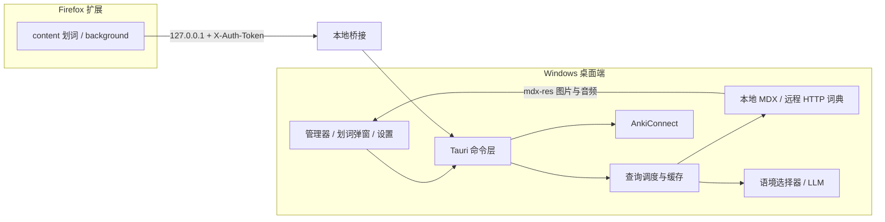

# LexiGrab

LexiGrab 是一个 Windows 优先的桌面划词词典。在任意应用或网页中选中一个词，按一次全局快捷键查看释义，并把词、释义、原句和来源写入 Anki。

产品范围见 [docs/PRD.md](docs/PRD.md)，界面与操作路径见 [docs/APP_FLOW.md](docs/APP_FLOW.md)，接口与存储契约见 [docs/BACKEND_STRUCTURE.md](docs/BACKEND_STRUCTURE.md)。

## 定位

它不是词典阅读器，也不是完整的 Anki 客户端。它解决三个具体问题：

1. 查词需要切换窗口、复制粘贴，打断阅读。
2. 本地 MDX 词典、远程词典接口和浏览器划词工具各自为政。
3. 制卡需要手动搬运词、释义和原句，原句经常丢失。

桌面端常驻托盘，负责词典、缓存、语境辅助与 Anki；Firefox 扩展只负责网页里的选区、原句和页面信息，通过本机 HTTP 桥接请求桌面端。

## 功能

- 全局快捷键唤起划词弹窗，默认 `Ctrl+Shift+D`，快速模式不抢原应用焦点。
- 本地 `.mdx` 词典查询，一个源可挂多个文件；同目录同名 `.mdd` 自动提供图片与音频。
- 远程 HTTP 词典：URL 模板、固定鉴权头、JSONPath 或 JavaScript 脚本解析。
- 三种查询策略：`local_first`（默认）、`first_hit`、`aggregate`。
- 查询缓存与语境缓存（SQLite），远程失败不阻断本地结果。
- 语境辅助：本地选择器按原句推荐义项；低置信度时可选用 LLM 生成语境释义，结果标注模型且默认不选中。
- AnkiConnect 制卡：牌组、笔记类型、四字段映射、标签、编辑原句与释义源码。
- 同词多卡：同一单词的不同原句或不同义项可分别保存；应用层只提示“同词同句同释义”。
- Firefox 扩展：页面划词、原句提取、页面气泡查询与制卡。
- 三套浅色主题：`figma`（默认）、`apple`、`cursor`。
- 中文界面，无账户、无遥测、无云同步。

## 系统要求

| 项 | 要求 |
| --- | --- |
| 操作系统 | Windows 10 22H2 或 Windows 11，x64 |
| 运行时 | Microsoft Edge WebView2 Runtime |
| Anki | 已安装 Anki，并安装 AnkiConnect 插件（代码 `2055492159`） |
| 浏览器扩展 | Firefox 109 或更高版本 |
| 从源码构建 | Node.js 24.22.1、pnpm 11.28.5、Rust 1.99.1、MSVC C++ 生成工具、WebView2 |

macOS 与 Linux 未验收，0.1.0 不承诺可用。

## 安装

0.1.0 以源码构建产物分发，不提供自动更新，安装包与 `.xpi` 均未签名。

```powershell
pnpm install
pnpm tauri build
```

桌面端安装程序位于 `src-tauri/target/release/bundle/nsis/`。运行安装程序后，应用常驻托盘；关闭管理器或设置窗口只隐藏窗口，退出请使用托盘菜单。

未签名安装包可能被 SmartScreen 拦截，这是发布方式的已知限制，不是安装失败。

### Firefox 扩展

扩展需要单独构建和安装，步骤见 [docs/extension.md](docs/extension.md)。未签名 `.xpi` 可以在 Firefox Developer Edition / Nightly 中关闭签名校验后安装；正式版只能通过 `about:debugging` 临时加载，重启 Firefox 后失效。

## 配置 AnkiConnect

1. 在 Anki 中打开“工具 → 附加组件 → 获取附加组件”，输入代码 `2055492159`，安装后重启 Anki。
2. 保持 Anki 运行。AnkiConnect 默认监听 `http://127.0.0.1:8765`，LexiGrab 默认连接 `http://localhost:8765`。
3. 打开 LexiGrab 的“设置 → Anki”，填写 endpoint，点击“测试连接”。
4. 选择牌组与笔记类型，确认四个字段映射：`Word`、`Definition`、`Sentence`、`Source`。
5. 按需填写标签；默认标签为 `global-dict`。
6. 选择同语境重复策略：`warn` 在“同词同句同释义”时提示，`allow` 静默保存。两种策略都不会阻止不同语境建卡。

四字段契约不包含页面 URL，扩展捕获的 URL 不会写入卡片。本地图片与音频不会上传到 Anki，导出时替换为 `[图片]`、`[音频]` 等占位文本。

## Firefox 扩展

扩展把页面选区、所在句子、URL、标题和域名通过 `127.0.0.1` 上的本地桥接发给桌面端。桌面端负责查询与制卡，扩展不直接访问 AnkiConnect、远程词典或选择器。

配对步骤：

1. 桌面端“设置 → 浏览器扩展”，确认启用，复制端口（默认 `12787`）与配对令牌。
2. 打开扩展设置页，填入端口与令牌，点击“测试连接”。
3. 回到网页划词，点击选区旁的浮动按钮，在气泡中查看结果或保存。

详细构建、安装、错误码与隐私说明见 [docs/extension.md](docs/extension.md)。

## 架构



分层、线程边界与一次查词的完整数据流见 [docs/ARCHITECTURE.md](docs/ARCHITECTURE.md)。

## 配置示例

完整字段、类型、默认值与保存规则见 [docs/configuration.md](docs/configuration.md)。下面是首次启动生成配置的节选；`device_id` 与 `token` 由应用生成。

```toml
[meta]
schema_version = 2
device_id = "首次启动生成的 UUID"

[general]
hotkey = "CmdOrCtrl+Shift+D"
theme = "figma"
query_strategy = "local_first"
max_entries_per_source = 3
max_entries_total = 20
start_minimized = false

[anki]
endpoint = "http://localhost:8765"
deck = "Default"
model = "Basic"
tags = ["global-dict"]
duplicate_policy = "warn"
field_map = { word = "Word", definition = "Definition", sentence = "Sentence", source = "Source" }

[bridge]
enabled = true
port = 12787
token = "首次启动生成的 64 位十六进制令牌"

[cache]
ttl_hours = 24
negative_ttl_minutes = 5

[sense]
enabled = false
selector_endpoint = "http://127.0.0.1:8787/v1/select"
selector_timeout_ms = 800
selector_allow_remote = false
low_confidence = 0.55
high_confidence = 0.72
max_senses = 20

[llm]
enabled = false
endpoint = "http://127.0.0.1:11434/v1/chat/completions"
model = ""
api_key_env = "LEXIGRAB_LLM_API_KEY"
timeout_ms = 15000
max_tokens = 320
allow_remote = false
cache_ttl_hours = 168

[[sources]]
id = "local-00000001"
name = "Mini"
type = "local_file"
enabled = true
priority = 10
paths = ["dictionaries/mini.mdx"]
```

## 隐私

- 应用不包含遥测、账户、云同步或崩溃上报，词典、缓存、日志都在本机。
- 配置与缓存以明文保存在用户目录；桥接令牌也以明文保存在配置中，依赖 Windows 用户目录权限，不声称加密。
- 本地桥接只监听 `127.0.0.1`，校验 `X-Auth-Token` 与 Firefox 扩展 Origin，并限制请求体与速率。
- 远程词典、语境选择器与 LLM 都是可选能力，只有用户配置并启用后才会访问网络。启用远程词典后，查询词会发送到该服务；远程响应解析脚本是本地代码，沙箱不是强隔离，只应运行可信脚本。
- 启用语境辅助后，词、原句和候选义项会发送给选择器；选择器默认只允许回环地址。
- LLM 默认关闭，默认端点也是回环地址。启用远程端点需要显式允许，确认后原句与候选义项会发送到该服务。API key 只从环境变量读取，不写入配置或日志。
- 扩展捕获的词、原句、URL、标题和域名只发送到本机回环桥接；本地图片与音频在返回给浏览器前被剥离。
- 日志不记录令牌、完整原句、完整 URL 或 API key。

## 从源码构建

环境：Windows、Node.js 24.22.1、pnpm 11.28.5、Rust 1.99.1、MSVC C++ 生成工具、WebView2。依赖版本以 `pnpm-lock.yaml` 与 `src-tauri/Cargo.lock` 为准。

```powershell
pnpm install
pnpm tauri dev
```

构建桌面端安装程序：

```powershell
pnpm tauri build
```

构建与打包 Firefox 扩展：

```powershell
pnpm -C extension build:firefox
pnpm -C extension package:firefox
```

扩展产物位于 `extension/dist/lexigrab-firefox-0.1.0.xpi`。

运行检查：

```powershell
pnpm typecheck
pnpm lint
pnpm test
pnpm -C extension typecheck
pnpm -C extension test
cd src-tauri
cargo fmt --check
cargo clippy --all-targets -- -D warnings
cargo test
```

开发 CLI 可以在不启动窗口的情况下验证查询链路：

```powershell
cd src-tauri
cargo run --bin lexigrab-dev -- lookup --config tests/fixtures/mini-config.toml --word hello --json
```

更多模块、测试与调试说明见 [docs/development.md](docs/development.md)。

## 许可证

LexiGrab 以 GNU Affero General Public License v3.0（AGPL-3.0）发布，许可证全文见 [LICENSE](LICENSE)。修改并通过网络提供本程序时，需要按 AGPL-3.0 提供对应源代码。

## 已知限制

1. 仅 Windows 10/11；macOS/Linux 未验收。
2. 仅 MDX/MDD，不保证全部私有变体。
3. 桌面句子捕获尽力而为。
4. 扩展未签名；正式版需临时加载或自行签名。
5. Anki 导出不含本地媒体，只留占位文本。
6. 四字段没有 URL；页面来源不写入卡片。
7. QuickJS 沙箱不是强隔离，只运行可信脚本。
8. 安装包未签名，SmartScreen 可能拦截。
9. 配置/缓存明文存本机，不提供云同步。
10. 不提供自动更新。
11. 义项切分依赖词典 HTML 结构；无法拆分时整条释义作为一个候选。
12. JEV-like 置信度是模型自评，可能过度自信；阈值可调但仍需人工确认。
13. AI 释义由 LLM 生成，可能不准确；默认关闭，必须手动采用。
14. 同一单词允许重复卡片；应用层只提示“同词同句同释义”，不保证 Anki 侧历史完全一致。

## 目录指引

| 文档 | 内容 |
| --- | --- |
| [docs/user-guide.md](docs/user-guide.md) | 首次启动、添加词典、划词、义项与 AI、编辑保存、扩展配对、失败恢复 |
| [docs/configuration.md](docs/configuration.md) | 配置文件位置、schema v2、逐节字段与保存规则 |
| [docs/extension.md](docs/extension.md) | `.xpi` 构建与安装、配对、错误码、隐私 |
| [docs/development.md](docs/development.md) | 模块地图、线程边界、测试、验证矩阵、发布流程、构建限制 |
| [docs/troubleshooting.md](docs/troubleshooting.md) | 按症状排查热键、捕获、词典、Anki、扩展、远程源与缓存 |
| [docs/performance.md](docs/performance.md) | 性能目标、实测数据、长跑方法与未覆盖项 |
| [docs/security.md](docs/security.md) | 十项安全审查结论与残余风险 |
| [CHANGELOG.md](CHANGELOG.md) | 版本变更记录 |
| [docs/PRD.md](docs/PRD.md) | 产品范围、用户故事与成功标准 |
| [docs/APP_FLOW.md](docs/APP_FLOW.md) | 窗口、页面、状态与错误路径 |
| [docs/ARCHITECTURE.md](docs/ARCHITECTURE.md) | 分层、数据流与边界 |
| [docs/BACKEND_STRUCTURE.md](docs/BACKEND_STRUCTURE.md) | 数据结构、IPC、桥接与存储契约 |
| [docs/TECH_STACK.md](docs/TECH_STACK.md) | 锁定版本与依赖 |
| [docs/FRONTEND_GUIDELINES.md](docs/FRONTEND_GUIDELINES.md) | 设计系统、主题与组件规则 |
| [ROADMAP.md](ROADMAP.md) | 组件位置与阶段状态 |
