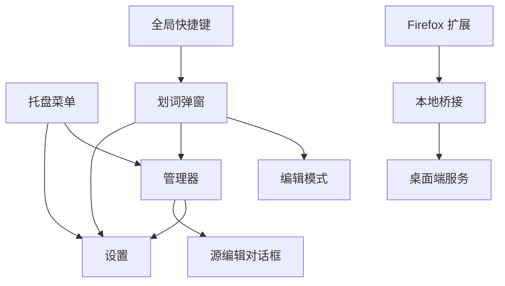
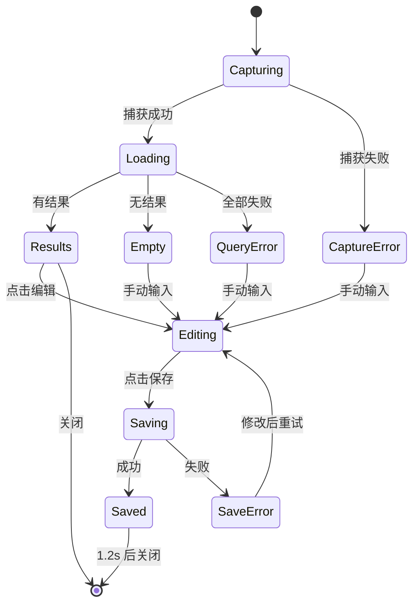

# APP_FLOW

本文件定义 LexiGrab 的窗口、页面、导航路径与状态转换。接口字段与端点见 [BACKEND_STRUCTURE.md](BACKEND_STRUCTURE.md)，视觉规则见 [FRONTEND_GUIDELINES.md](FRONTEND_GUIDELINES.md)。本文件不重复产品范围，范围见 [PRD.md](PRD.md)。

## 1. 导航模型

桌面端是三个独立窗口，不使用前端路由器。每个窗口一个 HTML 入口，窗口 label 固定：

| 窗口 | label | 入口 | 默认可见 | 说明 |
| --- | --- | --- | --- | --- |
| 管理器 | `manager` | `manager.html` | 首次启动可见 | 词典源、查询测试、运行状态 |
| 划词弹窗 | `popup` | `popup.html` | 隐藏 | 快捷键或调试命令触发 |
| 设置 | `settings` | `settings.html` | 隐藏 | 五个设置分区 |

页面内导航用 URL 查询参数表达，刷新后保持在同一分区：

- `manager.html?view=sources`（默认）
- `manager.html?view=test`
- `manager.html?view=status`
- `settings.html?section=general`（默认）
- `settings.html?section=anki`
- `settings.html?section=extension`
- `settings.html?section=cache`
- `settings.html?section=about`

不引入路由库。切换分区只更新查询参数并渲染对应面板。

`popup.html` 不接受路由参数。弹窗内容由最近一次选区、查询结果和编辑模式决定。

## 2. 屏幕清单

### 2.1 管理器

| 屏幕 | 目的 | 主要操作 |
| --- | --- | --- |
| 词典源 | 管理本地与远程源 | 添加、编辑、启停、排序、删除、查看状态 |
| 查询测试 | 用当前配置测试查询 | 输入词、选择源、查看 Entry 与耗时 |
| 运行状态 | 查看热键、Anki、桥接、缓存摘要 | 重试探测、打开设置、查看日志目录 |
| 添加/编辑源对话框 | 配置单个源 | 选择文件、填写 URL、测试、保存 |
| 首次启动引导 | 完成最小配置 | 添加词典、配置 Anki、设置热键 |
| 删除确认对话框 | 防误删 | 确认删除配置 |

### 2.2 划词弹窗

| 屏幕/模式 | 目的 | 主要操作 |
| --- | --- | --- |
| 快速模式 | 预览释义并直接制卡 | 保存、编辑、关闭、打开管理器 |
| 编辑模式 | 修改原句与释义 | 预览/源码切换、保存、取消 |
| 加载态 | 等待本地或远程结果 | 取消（关闭弹窗）、查看进度 |
| 空态 | 没有命中 | 仍然制卡、手动输入、打开词典管理 |
| 错误态 | 捕获或查询失败 | 重试、手动输入、打开日志 |

### 2.3 设置

| 分区 | 主要内容 |
| --- | --- |
| 通用 | 热键、主题、查询策略、结果条数、启动行为 |
| Anki | endpoint、牌组、模板、字段映射、标签、重复控制 |
| 浏览器扩展 | 启用、端口、令牌、状态、配对步骤 |
| 缓存 | TTL、统计、清理 |
| 关于 | 版本、目录、许可证、仓库链接 |

### 2.4 浏览器扩展

| 屏幕 | 目的 |
| --- | --- |
| 页面气泡 | 展示释义、原句与来源，触发保存 |
| 扩展设置页 | 填写端口与令牌，测试连接 |
| 首次安装提示 | 引导打开设置页 |

## 3. 全局导航



- 托盘左键：打开管理器。
- 托盘菜单：打开管理器、设置、退出。
- 管理器/设置的关闭按钮：隐藏窗口，不退出进程。
- 退出只从托盘菜单触发。
- 第二次启动：显示已有管理器，不创建新进程。
- 从弹窗打开管理器或设置：弹窗隐藏，目标窗口前置。

## 4. 首次启动

触发条件：配置不存在，或存在但没有完成引导。

```text
启动
  → 创建默认配置与令牌
  → 打开管理器（view=sources）
  → 显示三步引导卡片
     1. 添加词典
     2. 配置 Anki
     3. 设置热键
  → 每步完成即时打勾
  → 全部完成或用户关闭 → 引导收起到“运行状态”
```

决策点：

- 没有 `.mdx` 文件：允许跳过，弹窗会对空结果给出“添加词典”入口。
- Anki 未运行：允许跳过，保存时再提示。
- 热键冲突：必须换一个或保留默认并提示冲突。

## 5. 词典源管理

### 5.1 列表

进入 `view=sources`：

1. 拉取 `list_sources` 与 `get_source_statuses`。
2. 按优先级升序渲染。
3. 订阅 `dict://index-progress` 更新加载状态。
4. 顶部显示“添加源”，空列表显示引导。

行内状态：

```text
disabled → 不创建 worker
loading  → spinner + “正在加载”
ready    → 条目数
failed   → 错误摘要 + “重试”
```

### 5.2 添加本地源

```text
点击“添加源” → 选择“本地词典”
  → 文件选择器（多选 .mdx）
  → 校验扩展名、可读性、重复路径
  → 输入名称（默认首个文件名）
  → 自动提示同名 .mdd
  → 保存
      ├─ 成功：关闭对话框，列表新增 loading 行
      └─ 失败：留在对话框，显示字段错误
  → 后台打开词典
      ├─ ready：显示条目数
      └─ failed：显示错误与重试/编辑/删除
```

规则：

- 重复路径在任何源中出现时拒绝，并指出冲突源名称。
- 只删除配置，不删除磁盘文件。
- 源 ID 由后端生成，前端不编辑。

### 5.3 编辑与排序

- 编辑：名称、路径列表、启用状态、优先级。
- 启停：立即保存并生效，不打开对话框。
- 排序：上移/下移，内部重写 priority 为 10、20、30…。
- 路径变化触发重载；未变化不重启 worker。
- 删除需二次确认。

### 5.4 查询测试

进入 `view=test`：

1. 选择“全部启用源”或单个源。
2. 输入词，点击“查询”。
3. 显示加载态；返回 Entry 列表、来源、耗时。
4. 失败显示错误码与建议动作。
5. 清空输入回到空态。

此页面不写缓存，不触发弹窗。

## 6. 划词弹窗

### 6.1 热键到结果显示

```text
按热键
  → 250ms 去抖
  → 捕获选区（≤180ms）
      ├─ 失败：显示错误态
      └─ 成功：显示弹窗（快速模式）
  → 并行尝试句子捕获（≤120ms，失败留空）
  → 前端带 query_id 调用 lookup
  → 本地与缓存结果返回
      ├─ 有结果：渲染结果
      ├─ 无结果：空态
      └─ 全部源失败：错误态
  → 远程源未命中时显示“正在查询 N 个远程源”
  → 远程事件到达后追加结果
```

焦点规则：

- 快速模式不抢焦点。
- 编辑模式才主动激活窗口。
- 关闭后恢复触发前的前台窗口。

### 6.2 弹窗状态机



### 6.3 快速模式布局

从上到下：

1. 单词、音标、来源徽标、关闭。
2. 释义预览（可滚动，图片/音频内联）。
3. 原句预览（两行，空则提示）。
4. 远程进度条（有远程源时）。
5. 主按钮“保存到 Anki”，次按钮“编辑”，更多菜单“打开词典管理”“设置”。

行为：

- 点击“保存”直接使用当前词、释义、原句、来源。
- 点击“编辑”进入编辑模式并激活窗口。
- 点击“关闭”隐藏弹窗并恢复焦点。
- 按热键再次按下：隐藏。

### 6.4 编辑模式

1. 窗口变为 560×640，获得键盘焦点。
2. 原文与源码两个 tab；源码可编辑 HTML，预览实时刷新但只做展示。
3. 原句 textarea 可编辑，允许为空。
4. 单词只读，来源只读。
5. `Ctrl+Enter` 保存，Esc 取消。
6. 保存失败保留全部输入并显示错误。

### 6.5 保存结果

| 结果 | 界面 | 后续 |
| --- | --- | --- |
| 成功 | 显示 note id 与“已保存” | 1.2s 后隐藏 |
| 重复 | 提示已存在同类卡片 | 留在编辑模式，可改原句或允许重复 |
| Anki 未运行 | 显示安装/启动指引 | 留在弹窗，提供“重试” |
| 字段缺失 | 指明缺失字段 | 提供“打开设置” |
| 网络/内部错误 | 通用错误 + 详情 | 可复制诊断信息 |

## 7. 设置

### 7.1 通用

```text
修改热键 → 录制组合键 → 点击保存
  → 后端尝试注册
      ├─ 成功：注销旧热键，写配置
      └─ 冲突：恢复旧热键，提示，不写盘
```

- 主题切换立即预览，保存后持久化。
- 查询策略与条数保存后影响新查询，不重载词典。
- 启动行为保存后下次启动生效。

### 7.2 Anki

1. 进入分区异步探测 AnkiConnect。
2. 可用：显示版本，拉取牌组与模板。
3. 不可用：显示三步引导，不阻塞其他设置。
4. 选择模板后拉取字段，刷新字段映射下拉框。
5. 保存前校验四个映射非空、字段存在于模板。
6. “测试连接”只读，不写测试卡片。

### 7.3 浏览器扩展

1. 显示启用开关、端口、运行状态、最近请求时间。
2. 令牌默认遮罩，可显示/复制。
3. “重新生成令牌”二次确认，确认后立即生效。
4. “配对步骤”展开显示三步。
5. 端口保存后重启服务；失败保留输入并显示占用错误。

### 7.4 缓存

1. 显示条目数、占用、TTL。
2. 修改 TTL 保存后影响新写入；旧条目按原过期时间。
3. “清除缓存”二次确认，完成后刷新统计。

### 7.5 关于

- 版本、构建信息、配置/日志/缓存目录。
- 打开目录按钮。
- 许可证与第三方清单入口。
- 重新打开首次引导。

## 8. 浏览器扩展

### 8.1 配对

```text
桌面端：设置 → 浏览器扩展 → 复制令牌
扩展：安装后自动打开设置页
  → 填端口（默认 12787）与令牌
  → 测试连接
      ├─ 成功：保存并关闭提示
      ├─ 401：令牌错误
      └─ 失败：桌面端未启动或端口不对
```

### 8.2 页面划词

```text
选中文本（mouseup / Shift+方向键）
  → 120ms 后生成快照（词、句、URL、标题、域名）
  → 在选区附近显示浮动按钮
  → 点击按钮
  → background 调 /v1/selection
  → 气泡显示加载态
      ├─ 结果：展示最多 3 条释义
      ├─ 空：显示“未找到释义”
      └─ 错误：按错误码给出动作
  → 点击“保存到 Anki”
  → background 调 /v1/anki
      ├─ 成功：按钮变“已保存”，2s 后关闭
      └─ 失败：显示错误，可重试
```

边界：

- 气泡在 Shadow DOM 内，不污染页面。
- Escape、点击外部、滚动隐藏。
- iframe 内选区不支持。
- 句子只读，编辑在桌面端完成。

## 9. 错误与成功状态

| 状态 | 呈现 | 动作 |
| --- | --- | --- |
| 热键冲突 | 设置页行内错误 | 重新录制 |
| 未捕获到文本 | 弹窗错误态 | 重试、手动输入 |
| 词典加载中 | 列表 spinner | 等待、取消不可用 |
| 词典加载失败 | 行内错误摘要 | 查看详情、重试、编辑 |
| 查询无结果 | 空态 | 仍然制卡、添加词典 |
| 远程失败 | 底部淡提示 | 无阻断动作 |
| 缓存命中 | “缓存”文本标记 | 无 |
| Anki 未运行 | 引导卡片 | 安装、重试 |
| 重复卡片 | 提示 | 修改或允许重复 |
| 字段缺失 | 指向设置 | 打开 Anki 设置 |
| 桥接未启动 | 扩展气泡提示 | 打开桌面端设置 |
| 令牌错误 | 扩展提示 | 重新配对 |
| 端口占用 | 设置页错误 | 换端口 |

## 10. 键盘与无障碍

- 管理器与设置：Tab 顺序符合视觉顺序，焦点环可见，Esc 关闭对话框。
- 弹窗快速模式：按钮可点击；热键可关闭。
- 弹窗编辑模式：`Ctrl+Enter` 保存，Esc 取消，Tab 可达所有输入。
- 所有图标按钮有 `aria-label`，错误与输入通过 `aria-describedby` 关联。
- 状态不能只靠颜色表达，必须有文字。
- 尊重 `prefers-reduced-motion`。

## 11. 导航决策表

| 用户意图 | 入口 | 结果 |
| --- | --- | --- |
| 查一个词 | 全局热键 | 弹窗快速模式 |
| 补原句 | 弹窗“编辑” | 编辑模式 |
| 管理词典 | 弹窗菜单、托盘、管理器 | 管理器 `view=sources` |
| 改 Anki 配置 | 管理器设置入口、托盘 | 设置 `section=anki` |
| 配对扩展 | 设置扩展分区 | 设置 `section=extension` |
| 清缓存 | 设置缓存分区 | 设置 `section=cache` |
| 看版本与目录 | 设置关于 | 设置 `section=about` |
| 退出应用 | 托盘菜单 | 注销热键并退出 |
